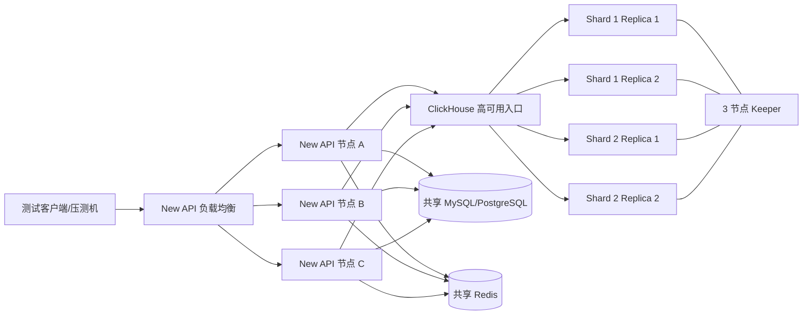

# New API 对接 ClickHouse 集群生产上线测试方案

## 1. 文档目的

本文档用于在生产上线前验证 New API、ClickHouse 集群和原 MySQL/PostgreSQL 日志库之间的完整链路。测试重点不是证明单个 ClickHouse 容器可以使用，而是确认在多 New API 节点、多 ClickHouse 分片和副本、真实网络波动以及部分基础设施故障时：

- 正常请求日志能够完整写入 ClickHouse；
- ClickHouse 集群内部可自行处理的故障不会误触发应用降级；
- New API 无法确认 ClickHouse 写入成功时，日志能够写入原 SQL 日志表；
- ClickHouse 恢复后，新日志能够自动切回 ClickHouse；
- 查询、统计和导出在故障期间按约定读取原 SQL 日志库；
- 故障期间的数据不会被误报为完整历史；
- 多节点配置同步、告警和实例标识符合预期；
- 迁移、上线和回滚过程中可以核对数据，且不会删除唯一副本。

本文所有故障注入命令只能在隔离的预发布环境执行，禁止直接对生产数据库、生产网络和生产容器执行。

## 2. 测试范围

### 2.1 包含范围

- New API 多节点部署和负载均衡；
- ClickHouse `Distributed` 表、分片、副本和 Keeper；
- ClickHouse 正常写入、读取、分页、过滤、统计和导出；
- 单副本、单分片、入口和网络故障；
- ClickHouse 写入失败后降级写入原 MySQL/PostgreSQL；
- ClickHouse 读取失败后降级查询原 SQL 日志库；
- 后台探测恢复和新日志切回；
- MySQL/PostgreSQL 单独故障及两个日志存储同时故障；
- 多 New API 节点配置同步和企业微信告警；
- 压力、连接池、资源和长时间稳定性；
- 历史数据迁移、正式切换和回滚演练。

### 2.2 不包含范围

- 自动将灾备期间日志回灌 ClickHouse；
- 自动去重迁移；
- 将 `quota_data` 迁移到 ClickHouse；
- 重新设计生产 ClickHouse 集群拓扑；
- 在生产环境直接进行破坏性故障注入。

## 3. 测试环境

### 3.1 推荐生产等价拓扑

| 角色 | 推荐数量 | 说明 |
| --- | ---: | --- |
| New API 节点 | 3 | 使用同一版本镜像，由负载均衡分发请求 |
| New API 入口 | 2 或托管 LB | 提供 VIP/域名，避免单入口故障 |
| ClickHouse Server | 4 | 建议 2 shard × 2 replica，结构与生产一致 |
| ClickHouse Keeper | 3 | 奇数节点；测试环境可以与 3 台 ClickHouse 主机同机，生产按运维方案部署 |
| ClickHouse 查询入口 | 2 或托管 LB | New API 的 `CLICKHOUSE_DSN` 指向此入口或等价高可用地址 |
| 主关系数据库 | 1 套高可用实例 | MySQL 或 PostgreSQL，所有 New API 节点共用 |
| Redis | 1 套共享实例或高可用集群 | 所有 New API 节点共用 |
| 压测和故障控制节点 | 1 | 运行流量生成、查询核对和网络故障注入工具 |
| 监控节点 | 1 | Prometheus/Grafana、日志采集或现有监控平台，可与压测节点合并 |

最低有效测试环境必须包含：2 个 New API 节点、2 个 ClickHouse 副本、1 个共享 SQL 数据库、1 个共享 Redis 和 1 个独立压测节点。最低环境只能验证节点切换，不能完整验证 2 shard × 2 replica 的分片故障。

预发布服务器规格至少应达到生产单节点规格的 50%，并保持相同的磁盘类型、网络路径和容器资源限制。没有现成生产规格时，可用以下规格作为首轮容量测试起点，最终容量仍以压测结果为准：

| 角色 | 起始规格建议 | 关键要求 |
| --- | --- | --- |
| New API | 4 vCPU / 8 GiB | 三个节点规格一致 |
| ClickHouse Server | 8 vCPU / 32 GiB / 本地 SSD 或 NVMe | 四个节点规格一致，磁盘容量至少为待迁移数据的 2 倍 |
| Keeper | 2 vCPU / 4 GiB | 三节点低延迟互通，避免跨高延迟地域 |
| SQL 数据库 | 不低于当前生产单节点规格 | 必须承受 ClickHouse 故障时的全部日志写入峰值 |
| Redis | 2 vCPU / 4 GiB | 与生产持久化和高可用策略一致 |
| 压测节点 | 8 vCPU / 16 GiB | 不与被测服务同机，避免压测机成为瓶颈 |

CPU、内存和磁盘数值不是生产最终容量结论。若预计生产峰值无法在上述规格达到，先提高测试环境规格，再执行容量验收。



### 3.2 网络要求

测试前记录实际开放端口，至少确认：

| 流向 | 常见端口 | 用途 |
| --- | ---: | --- |
| 客户端 → New API LB | 443/3000 | API 和管理后台 |
| New API → ClickHouse 入口 | 9000 或 8443 | 原生 TCP 或 TLS 连接 |
| ClickHouse 节点之间 | 按集群配置 | 分片、复制和分布式写入 |
| ClickHouse → Keeper | 9181 等 | 复制协调 |
| New API → MySQL | 3306 | 主库及日志灾备 |
| New API → PostgreSQL | 5432 | 主库及日志灾备 |
| New API → Redis | 6379 或 TLS 端口 | 共享缓存及配置通知能力 |

所有服务器必须启用时间同步。测试报告应记录 NTP 状态和各节点时区，避免日志时间窗口核对错误。

### 3.3 New API 节点配置

所有节点必须使用：

- 相同的镜像摘要或版本号；
- 相同的 `SQL_DSN`，指向共享主数据库；
- 相同的 `LOG_SQL_DSN`；未设置时继续使用共享主数据库；
- 相同的 `REDIS_CONN_STRING`；
- 相同的 ClickHouse 集群入口和数据库名；
- 不同的 `CLICKHOUSE_NODE_ID`，取值范围 `0–1023`；
- 不同的 `NODE_NAME`，建议同时配置各自的 `NODE_HOST_IP`。

示例：

```yaml
environment:
  - SQL_DSN=postgresql://newapi:<password>@sql-vip:5432/new-api
  - REDIS_CONN_STRING=redis://:<password>@redis-vip:6379
  - CLICKHOUSE_DSN=clickhouse://newapi:<password>@clickhouse-vip:9000/logs
  - CLICKHOUSE_NODE_ID=0
  - NODE_NAME=new-api-01
  - NODE_HOST_IP=10.10.20.31
```

其他 New API 节点必须修改 `CLICKHOUSE_NODE_ID`、`NODE_NAME` 和 `NODE_HOST_IP`。测试配置不得提交真实密码到 Git。

### 3.4 ClickHouse 表结构

集群应由 ClickHouse 运维人员创建：

- 每个 shard 上的 `logs.logs_local`：`ReplicatedMergeTree`；
- 对 New API 暴露的 `logs.logs`：`Distributed`；
- 字段、分区和排序键与 `clickhouse-log-schema.md` 一致。

New API 的 DSN 指向 `logs.logs`，不直接连接某个 replica 的本地表。

## 4. 测试数据和核对规则

### 4.1 测试数据标识

每轮测试生成唯一批次号，例如：

```text
RUN_ID=ch-prodtest-20260917-01
```

每个请求使用唯一 `request_id`，并记录以下信息：

```text
RUN_ID、阶段、发送时间、命中的 New API 节点、请求 ID、模型、预期日志类型、响应状态
```

测试账号、渠道和 Token 必须是预发布专用资源，不使用真实客户数据。

### 4.2 核对字段

每条日志至少核对：

```text
user_id、created_at、type、username、token_name、model_name、quota、
prompt_tokens、completion_tokens、use_time、is_stream、channel_id、
token_id、group、request_id、upstream_request_id、other
```

`channel_name` 由业务库回填，不作为写入一致性字段。两个数据库的 `id` 不作为跨库同一记录的唯一判断依据。

### 4.3 数据完整性公式

正常阶段：

```text
生成的成功请求数 = ClickHouse 中对应批次的业务日志数
原 SQL 日志库中不应新增该批次日志
```

故障阶段：

```text
生成的成功请求数 = 原 SQL 日志库中对应批次的业务日志数
```

存在写入超时歧义时：

```text
ClickHouse 对应记录数 + 原 SQL 对应记录数 >= 生成的成功请求数
按 request_id、type、created_at 和业务字段去重后的联合记录数 = 生成的成功请求数
```

两个存储都不可用时不能承诺日志已保存，此时必须验证应用日志和告警明确记录失败。

## 5. 测试前检查

- [ ] 测试环境与生产使用相同的 New API 镜像和 ClickHouse 大版本。
- [ ] 所有 New API 节点连接同一个主数据库和 Redis。
- [ ] 每个 New API 节点的 `CLICKHOUSE_NODE_ID` 和 `NODE_NAME` 唯一。
- [ ] `logs.logs` 是预期的 `Distributed` 表，底层本地表存在于所有 shard。
- [ ] 所有副本均正常，复制队列无持续积压。
- [ ] ClickHouse 账号具有 `SELECT`、`INSERT` 和初始化检查所需权限。
- [ ] 主 SQL 库的 `logs` 表存在且字段完整。
- [ ] 已记录测试前两个日志库的行数和最大时间。
- [ ] 已备份测试数据库；故障注入目标经过二次确认，不是生产环境。
- [ ] 企业微信使用测试群机器人。
- [ ] 监控可以查看 New API、SQL、Redis、ClickHouse 和 Keeper 的 CPU、内存、磁盘、连接数及错误日志。

建议执行以下只读检查：

```sql
-- ClickHouse
SELECT database, name, engine
FROM system.tables
WHERE database = 'logs' AND name IN ('logs', 'logs_local');

SELECT cluster, shard_num, replica_num, host_name, is_local
FROM system.clusters
ORDER BY cluster, shard_num, replica_num;

-- MySQL/PostgreSQL
SELECT COUNT(*) AS total, MAX(created_at) AS latest FROM logs;
SELECT COUNT(*) AS rows, SUM(count) AS requests, MAX(created_at) AS latest
FROM quota_data;
```

## 6. 基础功能测试

### T01：服务和数据库连通性

步骤：

1. 启动全部 New API、ClickHouse、SQL 和 Redis 节点。
2. 从每个 New API 容器解析并连接 ClickHouse 入口域名。
3. 从每个 New API 容器连接共享 SQL 和 Redis。
4. 请求 `/api/status` 并检查容器健康状态。

通过标准：所有节点健康；连接地址一致；没有节点误连本机数据库或单个 ClickHouse replica。

### T02：已有表兼容性

步骤：对 `logs.logs` 执行 `SHOW CREATE TABLE` 和 `system.columns` 查询，再启动三个 New API 节点。

通过标准：New API 不修改已有表；21 个字段类型兼容；所有实例启动成功。

### T03：多节点正常写入

步骤：

1. 通过 New API 负载均衡连续发送不少于 10,000 个带唯一请求 ID 的测试请求。
2. 确认流量实际分布到全部 New API 节点。
3. 查询 Distributed 表及每个 shard 的本地表。

通过标准：

- 去重后的业务日志数等于成功请求数；
- `id` 无重复，`request_id` 与测试记录一致；
- 日志分布到全部 shard，副本最终一致；
- 正常期间原 SQL 日志表没有该批次的新记录；
- 请求、日志写入和查询没有新增错误。

### T04：明细、过滤、统计和导出

至少验证管理员、普通用户和托管用户：

- 分页和排序；
- 用户权限隔离；
- 时间、模型、Token、渠道、分组和请求 ID 过滤；
- 流式错误状态过滤；
- 费用、利润、RPM、TPM；
- 渠道、Token、用户/Token 趋势；
- Token Cache 统计；
- 超过 1,000 条的导出。

通过标准：ClickHouse 结果与相同测试数据在原 SQL 库中的基准计算一致，接口返回 `X-Log-Source: clickhouse`。

## 7. ClickHouse 集群故障测试

每个场景开始前记录两个库的计数；故障期间持续发送带唯一请求 ID 的流量；恢复后分别查询 ClickHouse、原 SQL 日志表和 New API 服务日志。

| 编号 | 故障场景 | 操作 | 预期行为 |
| --- | --- | --- | --- |
| F01 | 停止一个 replica | 停止任一非唯一副本 | ClickHouse 集群继续完成读写，不触发 SQL 降级 |
| F02 | 单个 replica 网络隔离 | 阻断该 replica 与其他 ClickHouse/Keeper 节点通信 | 可用副本继续服务；恢复后复制队列收敛 |
| F03 | 一个 shard 的一个副本故障 | 停止目标副本并持续写入 | 对应 shard 的其他副本接管，不降级 |
| F04 | 一个 shard 的全部副本故障 | 停止该 shard 所有副本 | Distributed 写入明确失败，New API 将新日志写入原 SQL 库 |
| F05 | ClickHouse 入口单节点故障 | 停止一个入口代理 | 高可用入口切换；成功写入时不降级 |
| F06 | ClickHouse 全部入口故障 | 停止所有入口或撤销 VIP | New API 写入和读取分别进入 SQL 降级 |
| F07 | Keeper 单节点故障 | 停止一个 Keeper | 法定人数仍在，副本写入继续正常 |
| F08 | Keeper 失去多数派 | 停止足够 Keeper 节点 | 按 ClickHouse 实际返回决定；无法确认写入时进入 SQL 降级 |
| F09 | ClickHouse 只读 | 将测试表或测试用户切为不可写 | 查询可继续；写入失败后仅写原 SQL 库；读写状态相互独立 |
| F10 | ClickHouse 磁盘空间不足 | 在专用测试卷制造受控低空间状态 | 写入失败并降级；不得影响主业务请求完成 |
| F11 | ClickHouse 账号权限错误 | 临时使用缺少 INSERT 或 SELECT 权限的测试账号 | 对应读或写链路独立降级，错误和告警可定位 |
| F12 | 表不存在或字段不兼容 | 仅在一次性测试库中删除字段或创建错误类型 | 启动检查失败或进入约定的启动降级，不修改错误表 |

单副本或单入口故障是否触发应用降级，取决于 ClickHouse 集群入口是否仍能完成当前操作。验收依据是 New API 收到的最终写入或查询结果，不是故障节点数量。

## 8. 网络故障测试

推荐在压测机与服务之间使用 Toxiproxy，或在指定测试主机使用 `tc netem`。每次故障注入都必须记录目标 IP、端口、开始时间、结束时间和恢复命令。

| 编号 | 网络条件 | 建议参数 | 观察重点 |
| --- | --- | --- | --- |
| N01 | 固定延迟 | 50 ms、200 ms、500 ms | p95/p99、连接池、是否误降级 |
| N02 | 延迟和抖动 | 200 ms ± 100 ms | 超时边界和错误率 |
| N03 | 丢包 | 1%、5%、10% | 重试、写入确认和重复风险 |
| N04 | 连接拒绝 | 关闭入口监听端口 | 首次失败耗时和 SQL 降级 |
| N05 | 黑洞连接 | 丢弃数据包但不返回 RST | 超时能否在配置范围内结束 |
| N06 | DNS 解析失败 | 让单个 New API 节点无法解析入口域名 | 只有该节点降级，其他节点继续使用 ClickHouse |
| N07 | DNS/IP 切换 | 切换入口地址对应 IP | 连接池是否淘汰旧连接并恢复 |
| N08 | 单向网络分区 | 只阻断 New API → ClickHouse | API 节点独立降级，SQL 和 Redis 保持正常 |
| N09 | 短时闪断 | 断开 1、3、5 秒后恢复 | 是否产生过度切换和重复告警 |
| N10 | 长时中断 | 持续 10 分钟以上 | 降级期间不重复探测，不持续阻塞业务请求 |

通过标准：

- 正常可恢复的集群内部故障由 ClickHouse 处理；
- New API 无法确认写入时，在当前写入超时后改写原 SQL 库；
- 进入降级后，后续请求不再逐条等待不可用的 ClickHouse；
- 降级写入不继承已超时请求的 Context，原 SQL 库仍有独立写入时间；
- 业务接口不向用户暴露内部主机名、IP、端口或驱动错误；
- 网络恢复后不会出现连接池永久停留在故障地址的情况。

## 9. 写入降级和恢复测试

### W01：运行中写入降级

1. 正常发送 100 条请求，确认全部进入 ClickHouse。
2. 阻断所有 New API 节点到 ClickHouse 入口的写连接。
3. 持续发送 1,000 条请求，记录客户端成功数和请求 ID。
4. 查询原 SQL `logs` 表。

通过标准：故障阶段成功请求对应的 1,000 条日志全部能在原 SQL 库中找到，所有业务字段完整。

### W02：并发切换

在正常流量持续时突然阻断 ClickHouse，分别测试 10、100 和预计生产峰值并发。

通过标准：

- 不出现进程崩溃、数据竞争或连接池耗尽；
- 按跨库去重后的请求记录覆盖率为 100%；
- 原 SQL 数据库 CPU、连接数和写延迟不超过其容量上限。

### W03：写入超时歧义

通过代理模拟“ClickHouse 已接收请求，但成功响应未返回 New API”。

通过标准：允许同一业务日志同时存在于 ClickHouse 和原 SQL 库；不允许两个数据库都没有。测试报告必须记录重复比例，后续补迁按请求 ID、类型、时间和业务字段去重。

### W04：写入自动恢复

恢复 ClickHouse 后持续发送测试请求。

通过标准：下一次恢复尝试成功后，新日志重新进入 ClickHouse；故障期间保存在原 SQL 库的记录不被删除、不自动回灌。

### W05：两个存储同时失败

同时阻断 ClickHouse 和原 SQL 日志库，再发送测试请求。

通过标准：

- New API 服务日志明确记录两边写入失败；
- 企业微信告警包含节点名称和故障类型；
- 不将该条日志标记为已可靠保存；
- 恢复任一存储后，新日志可以继续落库。

## 10. 查询降级和恢复测试

### R01：日志查询降级

关闭 ClickHouse 入口，分别打开管理员、普通用户和托管用户日志页面。

通过标准：

- 页面从原 SQL 日志库返回数据；
- 用户权限隔离不变；
- 响应头为 `X-Log-Source: original`；
- 前端只显示一条“备用日志，部分历史可能暂时不可见”的提示；
- 页面不显示数据库地址、DNS、端口和驱动错误。

### R02：统计接口降级

验证费用、利润、RPM/TPM、渠道趋势、Token 趋势和 Token Cache 统计。

通过标准：每个请求全程使用原 SQL 库，不将 ClickHouse 和 SQL 结果拼接；接口结果只代表原库中已有数据。

### R03：流式扫描中断

让 ClickHouse 在统计查询已经返回部分记录后中断连接。

通过标准：当前统计请求失败并返回普通错误，不继续使用 SQL 拼接结果；服务端保留具体错误。下一次请求可以使用原库。

### R04：后台恢复探测

1. 保持业务查询流量运行。
2. 恢复 ClickHouse。
3. 不通过业务查询主动探测，观察后台任务。

通过标准：在“探测间隔 + 单次探测超时 + 调度误差”内解除读取降级；之后的新查询返回 `X-Log-Source: clickhouse`。

### R05：原库正常模式

在未配置 `CLICKHOUSE_DSN` 的环境中执行全部日志查询。

通过标准：接口返回 `X-Log-Source: sql`，前端不显示灾备提示，功能保持原有 MySQL/PostgreSQL/SQLite 行为。

## 11. 多 New API 节点测试

### M01：节点 ID 唯一性

三个 New API 节点同时高并发写入同一个 ClickHouse 集群。

通过标准：`id` 不重复；每个实例的 `CLICKHOUSE_NODE_ID` 不同。

### M02：单应用节点网络故障

只阻断节点 A 到 ClickHouse 的网络，节点 B/C 保持正常。

通过标准：A 写入原 SQL 库，B/C 继续写 ClickHouse；A 的读取状态不覆盖 B/C 的状态。

### M03：后台配置同步

在节点 A 保存自动恢复、探测间隔、探测超时和告警配置，直接查询节点 B/C 的运行行为。

当前实现的验收预期：

- 节点 A 立即生效；
- 节点 B/C 通过共享 `options` 表同步；
- 同步延迟不超过 `SYNC_FREQUENCY`，默认 60 秒；
- `CLICKHOUSE_DSN`、`CLICKHOUSE_NODE_ID`、`NODE_NAME` 和 `NODE_HOST_IP` 不通过后台同步，它们由各实例部署配置提供。

上线阻断条件：所有 New API 节点没有连接同一个主数据库时，不允许按集群模式上线。

已知缺陷及后续正确方案：后台当前逐项保存配置，其他节点可能短暂读取到中间状态；单项保存还需要确保数据库错误能够返回。生产增强方案应使用共享数据库事务批量保存，提交成功后通过共享 Redis 通知所有节点立即刷新，并保留定时数据库轮询作为兜底。

### M04：多节点告警

分别制造单节点网络故障和 ClickHouse 全局故障。

通过标准：告警中的 `NODE_NAME`、`NODE_HOST_IP` 和容器实例名能定位节点。同一实例在同一状态中不重复告警。

当前告警按实例去重。若产品要求“整个 New API 集群只发一条告警”，需另行增加 Redis 分布式去重；不能按现有行为验收为全局单条告警。

### M05：滚动重启

依次重启 New API 节点，期间保持负载。

通过标准：入口持续可用；重启节点恢复配置；各节点日志 ID 不冲突；没有因旧连接残留造成持续降级。

## 12. `quota_data` 专项验证

`quota_data` 不迁移到 ClickHouse，但上线前需要确认它继续覆盖两种日志写入路径。

1. ClickHouse 正常时发送一批消费请求。
2. ClickHouse 故障降级时发送另一批消费请求。
3. 等待 `DataExportInterval`，默认 5 分钟。
4. 查询主数据库 `quota_data`。

通过标准：两个阶段的成功消费都计入 `quota_data`；同一用户、用户名、模型和小时合并为一条或可正确求和的汇总；`count`、`quota`、`token_used` 与测试记录一致。

注意：`quota_data` 先写入每个 New API 实例的内存缓存，再定时刷新主库。进程在刷新前异常退出可能丢失尚未落库的汇总，因此它是看板派生数据，不作为日志零丢失和账务完整性的唯一证据。

## 13. 容量和稳定性测试

至少执行三个负载阶段：

| 阶段 | 流量 | 持续时间 | 目的 |
| --- | --- | --- | --- |
| 基线 | 日常平均流量 | 30 分钟 | 建立资源和延迟基线 |
| 峰值 | 预计生产峰值 | 60 分钟 | 验证正常容量 |
| 压力 | 峰值的 1.5–2 倍 | 30 分钟 | 找到容量边界，不作为正常运行目标 |
| 浸泡 | 日常流量 | 至少 24 小时 | 检查连接泄漏、内存增长和小分区问题 |

记录：

- 业务请求成功率及 p50、p95、p99；
- 首次 ClickHouse 故障请求的额外延迟；
- 进入降级后的请求延迟；
- ClickHouse 插入和查询错误率；
- New API 到 ClickHouse、SQL、Redis 的连接池使用量；
- ClickHouse CPU、内存、磁盘、merge、part 数和复制队列；
- SQL 灾备写入 QPS、连接数、锁等待和磁盘使用；
- New API CPU、内存、goroutine 数和重启次数。

默认上线门槛：

- 正常阶段业务成功率不低于基线；
- 正常阶段 p95 不高于基线 20%；
- 故障降级阶段成功请求的日志覆盖率为 100%；
- 无重复 ID、无进程崩溃、无连接池耗尽；
- 恢复后错误率回到基线；
- 24 小时浸泡期间内存和连接数无持续单向增长。

如果生产已有更严格的 SLO，以生产 SLO 为准。

## 14. 历史迁移和正式切换演练

### 14.1 在线预迁移

1. 保持旧版本 New API 运行，日志继续写入原 SQL 库。
2. 记录迁移起始 ID 和时间。
3. 分批将历史日志复制到 ClickHouse。
4. 每批核对源记录数、目标记录数、字段抽样和额度/Token 汇总。
5. 保存每批起止位置和执行结果，失败后从最后成功批次继续。

### 14.2 最终增量迁移

1. 进入维护窗口，从负载均衡摘除或停止所有写流量。
2. 等待在途请求结束和 `quota_data` 缓存刷新完成。
3. 记录原 SQL `logs` 表最终边界。
4. 迁移在线预迁移之后产生的最后一批日志。
5. 完成全量计数、分时计数、额度和 Token 汇总核对。

### 14.3 新版本切换

1. 部署启用 ClickHouse 的 New API 镜像。
2. 确认所有节点使用唯一 `CLICKHOUSE_NODE_ID`。
3. 逐节点验证 ClickHouse 写入，但正式开放流量前不要产生无法归类的业务测试数据。
4. 恢复负载均衡入口。
5. 持续观察至少 60 分钟，再进入正常监控期。

迁移期间不得删除原 SQL 日志。ClickHouse 写入超时可能在服务端实际成功后又触发 SQL 降级，因此补迁必须去重，不能直接按两个库的 `id` 判断。

## 15. 回滚演练

### 15.1 应用版本回滚

确认旧镜像、配置和启动命令可用，演练逐节点回滚并检查健康接口。

### 15.2 日志路径回滚

如果保留当前版本但 ClickHouse 不可用，New API 会自动将新日志写入原 SQL 库。若要彻底恢复旧版本，需先停止写流量，并将切换后只存在于 ClickHouse 的日志补回 SQL，否则旧版本只能看到 SQL 中的部分历史。

### 15.3 立即停止上线的条件

出现以下任一情况立即停止或回滚：

- 成功业务请求在两个日志库中均找不到；
- 用户权限隔离失效；
- 日志额度或 Token 汇总无法对账；
- SQL 灾备写入失败但应用未记录错误或未告警；
- 单副本故障导致整个 ClickHouse 入口不可用；
- 故障恢复后持续写入错误；
- New API 实例发生崩溃或资源持续增长；
- 数据库内部错误信息直接返回普通用户。

## 16. 上线观察和验收记录

### 16.1 上线阶段

建议采用以下顺序：

1. 预发布环境完整执行本方案。
2. 生产环境部署 ClickHouse 集群但暂不启用 New API 的 `CLICKHOUSE_DSN`。
3. 验证集群、表结构、权限、监控和备份。
4. 执行历史在线预迁移。
5. 在维护窗口完成最终增量迁移和 New API 版本切换。
6. 内部流量验证后恢复全部流量。
7. 持续监控 1 小时，随后保持 7 天重点观察。

当前实现没有按用户比例启用 ClickHouse 的功能开关。不要让不同 New API 节点长期运行不同的日志写入配置；混合部署会使新增日志持续分散在两个存储中。

### 16.2 每个用例的记录模板

```text
测试编号：
执行时间：
执行人员：
环境/版本：
测试批次 RUN_ID：
故障注入节点：
故障开始时间：
故障恢复时间：
发送请求数：
业务成功数：
ClickHouse 日志数：
原 SQL 日志数：
跨库去重后日志数：
重复数：
缺失数：
首次故障延迟：
降级后 p95/p99：
告警时间和内容：
恢复探测时间：
最终结果：通过 / 不通过
问题记录：
证据链接：
```

### 16.3 最终签字条件

- [ ] 所有基础功能测试通过。
- [ ] 所有计划内故障场景通过。
- [ ] MySQL 或 PostgreSQL 灾备路径与生产选型一致并通过。
- [ ] 真实生产峰值负载测试通过。
- [ ] 24 小时浸泡测试通过。
- [ ] 历史迁移、最终增量和去重方案演练通过。
- [ ] 应用及日志路径回滚演练通过。
- [ ] 告警接收人和处理手册已确认。
- [ ] 已知限制由产品、研发和运维共同确认。
- [ ] 测试报告包含所有关键 SQL、监控截图和日志证据。

## 17. 常用执行命令模板

以下命令中的容器名、账号、地址和 `RUN_ID` 都是占位值，执行前必须替换为预发布环境的实际值。

### 17.1 查询 ClickHouse 测试批次

```sql
SELECT
    count() AS rows,
    uniqExact(request_id) AS request_ids,
    sum(quota) AS quota,
    sum(prompt_tokens) AS prompt_tokens,
    sum(completion_tokens) AS completion_tokens,
    min(created_at) AS first_at,
    max(created_at) AS last_at
FROM logs.logs
WHERE startsWith(request_id, 'ch-prodtest-20260917-01');
```

逐 shard 核对本地表时，在每个 shard 执行：

```sql
SELECT
    count() AS rows,
    uniqExact(request_id) AS request_ids,
    sum(quota) AS quota
FROM logs.logs_local
WHERE startsWith(request_id, 'ch-prodtest-20260917-01');
```

检查副本状态：

```sql
SELECT
    database,
    table,
    is_readonly,
    is_session_expired,
    queue_size,
    absolute_delay,
    total_replicas,
    active_replicas
FROM system.replicas
WHERE database = 'logs';
```

检查 Distributed 待发送队列：

```sql
SELECT
    database,
    table,
    count() AS pending_files,
    sum(bytes) AS pending_bytes
FROM system.distribution_queue
WHERE database = 'logs'
GROUP BY database, table;
```

### 17.2 查询 PostgreSQL 灾备日志

```sql
SELECT
    COUNT(*) AS rows,
    COUNT(DISTINCT request_id) AS request_ids,
    COALESCE(SUM(quota), 0) AS quota,
    COALESCE(SUM(prompt_tokens), 0) AS prompt_tokens,
    COALESCE(SUM(completion_tokens), 0) AS completion_tokens,
    MIN(created_at) AS first_at,
    MAX(created_at) AS last_at
FROM logs
WHERE request_id LIKE 'ch-prodtest-20260917-01%';
```

### 17.3 查询 MySQL 灾备日志

```sql
SELECT
    COUNT(*) AS rows,
    COUNT(DISTINCT request_id) AS request_ids,
    COALESCE(SUM(quota), 0) AS quota,
    COALESCE(SUM(prompt_tokens), 0) AS prompt_tokens,
    COALESCE(SUM(completion_tokens), 0) AS completion_tokens,
    MIN(created_at) AS first_at,
    MAX(created_at) AS last_at
FROM logs
WHERE request_id LIKE 'ch-prodtest-20260917-01%';
```

### 17.4 Docker 节点故障示例

仅适用于预发布 Docker 环境：

```sh
# 停止一个副本
docker stop ch-s1-r1

# 恢复该副本
docker start ch-s1-r1

# 停止一个 shard 的全部副本
docker stop ch-s1-r1 ch-s1-r2

# 恢复该 shard
docker start ch-s1-r1 ch-s1-r2
```

停止前先通过 `docker inspect` 确认容器名称、所属环境和挂载目录。测试期间不删除容器和数据卷。

### 17.5 Linux 网络故障示例

以下命令只能在指定预发布节点执行。先通过 `ip route` 确认测试网卡，示例中的 `eth0` 不能直接照抄。

```sh
# 增加 200 ms 延迟和 100 ms 抖动
sudo tc qdisc add dev eth0 root netem delay 200ms 100ms

# 增加 5% 丢包
sudo tc qdisc replace dev eth0 root netem loss 5%

# 每个用例结束后恢复网络
sudo tc qdisc del dev eth0 root
```

应另外保留一条不经过故障网卡的管理连接，避免测试人员无法登录服务器执行恢复命令。生产环境禁止使用这些命令。

### 17.6 New API 日志关键字

故障测试期间至少检索以下日志：

```text
ClickHouse log writes degraded to the original log database
ClickHouse log writes recovered
ClickHouse log reads degraded to the original database
ClickHouse log reads recovered
original log database write failed
```

同时记录每条状态变化的 `NODE_NAME`、时间、请求 ID 和对应企业微信告警时间。
